<div align="center">




<br /><br />

<a href="https://muaaz-iqbal.github.io/MIZANORAORG/"></a>
<a href="https://github.com/muaaz-iqbal"></a>


<br />


</div>

---

## 👋 Hi, I'm Muaaz Iqbal

> **Full-Stack & Android Developer** — I build products that are fast under the hood and feel alive on the surface.
> Creator of **[Mizanora](#-featured-projects)** and **[Asaan-Lang](#-featured-projects)**.

```ts
const muaaz = {
  role:      ["Full-Stack Developer", "Android Developer", "Tooling Engineer"],
  location:  "Pakistan 🇵🇰",
  focus:     ["Web platforms", "Android apps", "Compilers", "Live-streaming"],
  principle: "Ship it clean, ship it fast, ship it beautiful.",
  openTo:    "Collaborations, freelance builds & ambitious ideas"
};
```

<table>
<tr>
<td width="50%" valign="top">

### 🎯 What I care about
- **Performance is a feature** — lean payloads, real budgets
- **Clarity over cleverness** — code a future maintainer will thank you for
- **End-to-end ownership** — schema → API → last transition curve
- **Motion with meaning** — animation that explains, not decorates

</td>
<td width="50%" valign="top">

### 🌱 Right now
- 🔭 Engineering the **Mizanora** platform
- 🌍 Growing **Asaan-Lang**, a beginner-first language & compiler
- 🎥 Improving low-latency **live-streaming** pipelines
- 📚 Sharpening **Android + systems** fundamentals

</td>
</tr>
</table>

---

## 🧰 Tech Stack

<div align="center">

**Web**


**Mobile & Systems**


**Cloud & Data**


</div>

---

## 🏆 Featured Projects

<table>
<tr>
<td width="50%" valign="top">

### ◈ Mizanora
The flagship platform — a performance-first web product with a clean architecture and a polished, motion-rich interface.

`Web Platform` · `Full-Stack` · `UI/UX`

<a href="https://github.com/muaaz-iqbal"></a>

</td>
<td width="50%" valign="top">

### ⌘ Asaan-Lang
A beginner-friendly programming language with its own compiler pipeline — lexer, parser and code generation, designed for learners.

`Compiler` · `Language Design` · `Education`

<a href="https://github.com/muaaz-iqbal"></a>

</td>
</tr>
<tr>
<td width="50%" valign="top">

### ▶ Live-Streaming Pipelines
Low-latency capture → encode → delivery workflows with automation glue that keeps everything lean and reliable.

`Streaming` · `Automation` · `Infra`

</td>
<td width="50%" valign="top">

### 📱 Android Apps
Native Android applications built with Material 3, offline-first behaviour and delightful micro-interactions.

`Kotlin` · `Android` · `Material 3`

</td>
</tr>
</table>

---

## 📊 GitHub Stats

<div align="center">


</div>

---

## 🚀 Run the site locally

```bash
# 1. Clone
git clone https://github.com/muaaz-iqbal/MIZANORAORG.git
cd MIZANORAORG

# 2. Serve (it's a zero-dependency static site)
python3 -m http.server 8080

# 3. Open
#    http://localhost:8080
```

> Deploys automatically to **GitHub Pages** on every push to `main` via
> [`.github/workflows/deploy-pages.yml`](.github/workflows/deploy-pages.yml).

---

## 🤝 Connect

<div align="center">

<a href="https://github.com/muaaz-iqbal"></a>
<a href="https://muaaz-iqbal.github.io/MIZANORAORG/"></a>

<br /><br />

**💬 Got an idea, a bug, or a bold build? Open an issue — let's make it real.**

</div>

---

<div align="center">


<sub>© 2026 <b>Mizanora Org</b> · Designed & engineered by <b>Muaaz Iqbal</b> 🇵🇰 · Licensed under MIT</sub>

</div>
